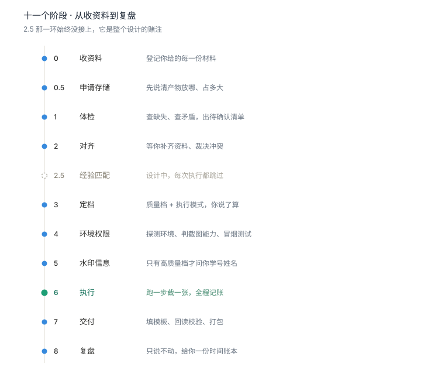
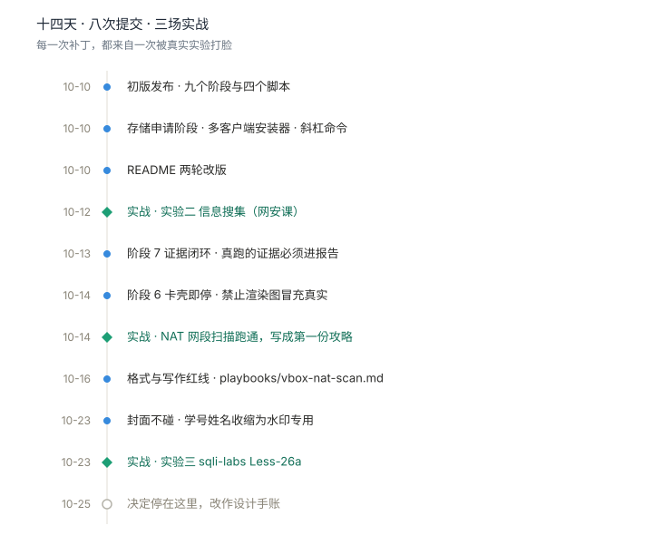
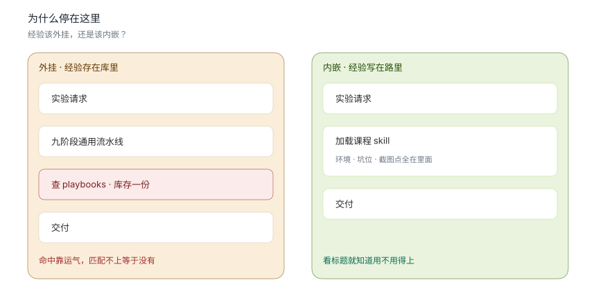

> ### 本仓库已停止开发
>
> 2026-10-10 立项 → 2026-10-23 最后提交 → 2026-10-25 归档。
>
> 两场实战验证，一处设计假设被证伪。代码冻结，不再维护，也不再作为 skill 安装使用。
>
> 以下内容作为设计存档保留：它想解决什么、跑通过什么、止步于哪一步。

---

## 它想做什么

大学实验作业的共同结构：读要求 → 搭环境 → 跑步骤 → 截图 → 填模板。

labrunner 的想法是把前四步交给 agent 在真实环境里跑完并攒齐证据，把需要理解的部分留给人。

**它承诺过：**

- 有明确的流程，不随机发挥
- 每一步在真实环境里执行
- 结果是真跑出来的，不是编的
- 截图是它自己截的
- 跑不通就降级，并且明确告诉你降在哪一步

---

## 十一个阶段



阶段 2.5 是整个设计的关键假设：一次实验跑完后，把踩过的坑自动沉淀成攻略，下次遇到同类实验时匹配加载，省掉一半试错。

这一环没有实现。图中用虚线空心圆标记。

---

## 十四天，八次提交，三场实战



每一次提交都对应一次实战中暴露的问题：

| 补丁 | 暴露的问题 |
|---|---|
| 阶段 7 证据闭环 | 只填了模板，真跑的证据没进报告 |
| 阶段 6 卡壳即停 | VM 截图拿不到，存在用渲染图替代的风险 |
| 格式与写作红线 | 报告排版踩了七八个坑（红字、代码缩进、回读校验） |
| 封面不碰 | 改封面文本框必中文乱码，收益为零 |

---

## 它真的跑过

### 实验二 · VirtualBox NAT 网段扫描

网安课设要求扫描 NAT 网段内的靶机，而 NAT「只出不进」—— 宿主机到不了任何 VM，
`ping 10.0.2.1` 百分百丢包。这不是配置错误，是模式特性。

最后的解法是把扫描平台放进网段内：在 Kali 里跑 nmap，宿主机通过
`VBoxManage guestcontrol` 内部通道下发命令、回收输出，绕开网络隔离。

六条踩坑记录整理成了 [`playbooks/vbox-nat-scan.md`](playbooks/vbox-nat-scan.md)。

### 实验三 · sqli-labs Less-26a

盲注关卡，空格、注释符、逻辑关键字全被过滤，而且页面不回显。tamper 脚本改了四版：

| 版本 | 想法 | 死因 |
|---|---|---|
| v1 | 空格 → `%a0` | utf8 下 0xa0 是非法字节，MySQL 直接 1064 |
| v2 | `AND` → `&&` | GET 参数里 `&` 是分隔符，注入被截断，还骗出一次误报 |
| v3 | `OR` → 双写 `OORR` | `preg_replace` 替换所有匹配，双写被删成 `d` |
| v4 | 空格 → `%0b`，关键字全局处理 | 通了 |

四版对应四次重跑。流水线假设一步一截、持续推进；调试要求改一版重跑一次、推翻重来。

这是 labrunner 最根本的一处错配：它按前者的节奏设计，而实验的八成是后者。

---

## 为什么停在这里



最初的设想是做通用引擎：所有实验走同一条流水线，经验存在库里，靠匹配注入。

实测更有效的做法是：每门课的实验跑通一次，就整理成它自己的 skill。
环境版本、踩过的坑、必截图的位置、老师的模板结构全部写死，下次直接跳过试错。

| | 外挂：通用引擎 + 经验库 | 内嵌：课程级 skill |
|---|---|---|
| 经验存放 | 中心库，运行时匹配命中 | 写在路里，无需匹配 |
| 加载成本 | 每次执行都要走匹配环节 | 一加载就是答案 |
| 类比 | 解释器：通用，慢且脆弱 | 编译产物：具体，直接可跑 |

---

## 留下了什么

代码不删，但真正被带走的是这几样：

| 带走 | 去向 |
|---|---|
| 红线五条（尤其"不编造结果"） | 写进每个实验 skill 的开头 |
| 「卡壳即停」规则 | 拿不到真实证据时如实告知，不糊弄 |
| 「封面不碰」的判断 | 改 docx 文本框必乱码，收益为零 |
| [`anti-mojibake.md`](references/anti-mojibake.md) | 编码防坑，与实验无关，通用 |
| [`vbox-nat-scan.md`](playbooks/vbox-nat-scan.md) | 攻略写作的范本 |
| [`watermark.py`](scripts/watermark.py) | 截图水印，改改还能用 |

带不走的：九阶段流水线、经验匹配设计、多客户端安装器。它们解的是通用调度问题，而实际需要的是具体课程的具体答案。

---

## 设计细节（存档）

### 质量档

| 档 | 图片 | 水印 |
|---|---|---|
| 高 | 关键步骤 + 结果必配 | 有（`姓名+学号` 全图斜铺） |
| 中 | 按需 | 无 |
| 低 | 无 | 无 |

### 执行模式

| 模式 | 说明 |
|---|---|
| A 全自动真图 | 本机 GUI / 虚拟机窗口可控，自动定位截图 |
| B 协作真图 | 云端 / 远程环境，它出《请截图清单》，你配合截 |
| C 无图文字 | 放弃截图，用文字 + 命令输出 |

任何档位都真实执行。跑不通就降级，并且明确告诉你降级在哪一步。

### 产出目录

```
outputs/<课程>-<实验名>-<日期>/
  00-raw/       原始资料副本（只读）
  01-work/      脚本、日志、timeline.md、frictions.md
  02-shots/     截图 step-<序号>-<说明>.png
  03-report/    最终报告
```

### 仓库结构

```
labrunner/
  SKILL.md                     主指令（流程 + 红线）
  docs/assets/                 本 README 的配图
  scripts/
    detect_encoding.py         编码探测与安全读取
    capture.py                 窗口定位 / 置前 / 截图（含 DPI 修正）
    watermark.py               高质量档水印
    fill_docx.py               按占位符填模板 + 回读校验
  references/
    quality-matrix.md          定档判定细则
    anti-mojibake.md           乱码防护细则
    experience-reuse.md        经验复用模块设计（已定稿，未实现）
    playbooks/                 攻略模板
    known-issues/              坑位库模板
  playbooks/
    vbox-nat-scan.md           NAT 网段扫描攻略（唯一一份真实产出）
  .local/                      个人配置（不上传 Git）
```

---

## 安装（已归档）

以下安装方式保留作为历史记录。**不再维护，不建议再装。**

<details>
<summary>展开查看原始安装说明</summary>

### Windows（PowerShell）

```powershell
git clone https://github.com/joes133/labrunner.git
cd labrunner
.\install.ps1
```

### macOS / Linux

```bash
git clone https://github.com/joes133/labrunner.git
cd labrunner
chmod +x install.sh && ./install.sh
```

### 支持哪些 agent

`SKILL.md` 用的是开放的 Agent Skills 标准，同一份文件在各家通用，
区别只有装到哪个目录。

| 客户端 | 安装位置 |
|---|---|
| WorkBuddy / CodeBuddy | `~/.workbuddy/skills/labrunner` |
| Claude Code | `~/.claude/skills/labrunner` |
| Cursor | `~/.cursor/skills/labrunner` |
| Codex CLI | `~/.codex/skills/labrunner` |
| OpenCode / Cline / Gemini CLI | `~/.agents/skills/labrunner` |
| Kiro | `~/.kiro/agents/labrunner` |

### 依赖

```bash
pip install pillow python-docx chardet
# Windows 上需要自动定位窗口，额外装：
pip install pywin32
```

</details>

---

## 关于学术诚信

labrunner 帮你**执行**实验、**整理**报告，不替你编造结果。

它不会生成可直接提交的成品答案 —— 所有的运行结果来自真实执行，
报告内容基于你提供的资料和真实产出的证据。

这条在它被放弃之后依然成立，也会写进后面每一个实验 skill 里。

---

## License

MIT

---

**2026-10-10 → 2026-10-25**
